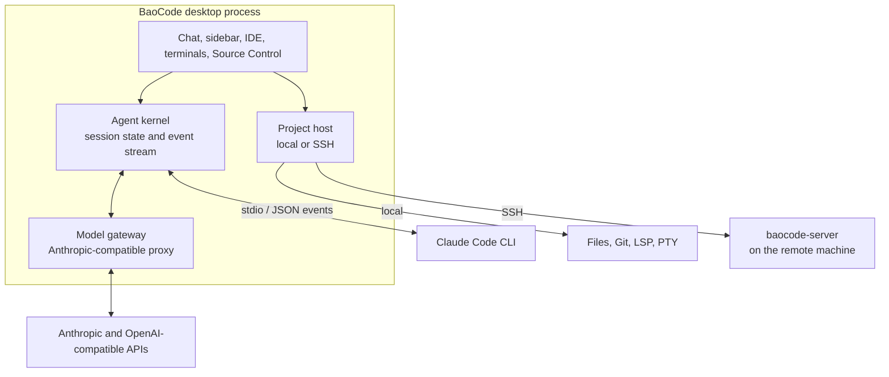

# BaoCode

A native desktop workspace for the Claude Code CLI.

BaoCode does not ship an agent of its own. It launches the `claude` executable
already installed on your machine, keeps your existing configuration, and turns
the agent's event stream into something you can read, search, review and act on
without leaving the window. Around that transcript it adds the rest of a working
environment: an editor, terminals, Git with a commit graph, language servers, a
model gateway, and SSH projects whose files and processes stay on the remote
host.

The interface is drawn by Flutter directly to the GPU, so the app starts in a
fraction of a second and a single window is measured in megabytes rather than
gigabytes.


## What you get

| Area | Highlights |
| --- | --- |
| Conversation | Streaming transcript, folded tool calls, message search, side-by-side sessions, queued follow-ups, `/goal` loops, token and cost reporting |
| Change review | Per-file Keep/Undo, inline diffs, rewind to a previous turn, checkpoints stored outside the project's `.git` |
| Composer | Rich text with file/line references, images and dropped files placed inline, long pastes stored as readable files, slash commands, per-session model choice |
| IDE | Monaco-derived editor, TextMate and Monarch highlighting, LSP diagnostics and navigation, explorer, project search, integrated terminals, Source Control and commit graph |
| Customization | VS Code, IntelliJ IDEA, Sublime Text and Atom keymaps; VS Code color themes; per-user and per-project skills, subagents, commands, rules, MCP servers, hooks and plugins |
| Models | Anthropic, OpenAI Chat Completions and OpenAI Responses upstreams through a local translation proxy; keys kept in the OS credential store |
| Remote | Open a folder over SSH; files, Git, search, terminals, language servers and Claude Code run on the remote host (Linux/macOS, x64/arm64) |
| Desktop | Multiple windows, menu bar/tray persistence, native notifications and sounds, background updates, English and Simplified Chinese UI, diagnostics export |

Some of these are deliberately narrow ports of their upstream counterparts.
[`packages/bao_editor/PARITY.md`](packages/bao_editor/PARITY.md) and
[`packages/bao_xterm/PARITY.md`](packages/bao_xterm/PARITY.md) record the exact
differences rather than claiming full parity.

## A closer look

| Composer | Models |
| --- | --- |
|  |  |
| Images, pasted files and quoted line ranges stay in the sentence. Long pastes are written to disk and referenced by path so the agent can read them. | Point an upstream at Anthropic's API, OpenAI Chat Completions or OpenAI Responses. The local proxy handles the translation; the key goes to the OS credential store. |

| Source Control | Themes |
| --- | --- |
|  |  |
| Stage a subset, write the message, and read the graph without leaving the window. Claude Code can draft the commit message. | The editor, transcript, terminal and sidebar all follow the selected VS Code theme. |

## How the pieces fit



The layers in the source tree mirror that diagram:

- **`lib/kernel/`** — `AgentKernel` and the typed event model (`KernelEvent`).
  The Claude Code adapter starts the CLI, translates its output into events and
  sends user turns, approvals and interrupts back. Session transcripts,
  checkpoints, queued messages and goals are assembled here.
- **`lib/chat/` and `lib/workspace/`** — presentation and window composition:
  the transcript, composer, review panels, split/grid layouts, sidebar and
  multi-window state.
- **`lib/ide/`** — editor integration, language servers, Git, search, debugger
  glue and terminals. The editor, terminal emulator and PTY primitives live in
  the standalone packages below.
- **`lib/remote/` plus `packages/bao_remote/`** — a `ProjectHost` abstraction
  with local and SSH implementations. The remote side is a headless Dart
  program speaking JSON-RPC over one SSH connection; it is downloaded on first
  use and cached under `~/.baocode-server/`.
- **`lib/models/`, `lib/network/`** — provider configuration, credential
  storage and the local proxy that lets Claude Code talk to non-Anthropic
  upstreams.
- **`lib/settings/`, `lib/theme/`, `lib/keybindings/`, `lib/update/`,
  `lib/telemetry/`, `lib/diagnostics/`** — supporting services shared by the
  rest of the app.

## Requirements

| | |
| --- | --- |
| Operating system | macOS 12 or newer (Apple silicon or Intel); Windows 10 or newer (x64) |
| Toolchain | Flutter with Dart `^3.13.4` (CI builds with Flutter 3.47.5) |
| Agent | [Claude Code](https://github.com/anthropics/claude-code) installed and available on `PATH` |
| Native build | Xcode command-line tools on macOS; "Desktop development with C++" with Visual Studio on Windows |
| Packaging only | Inno Setup 6 on Windows; a Developer ID certificate and notarization credentials on macOS for signed releases |

The editor's Oniguruma bindings and the PTY layer are built by Dart native-assets
hooks, so the first build also needs a working C toolchain.

## Run from source

```sh
git clone https://github.com/poying2018/baocode.git
cd baocode
flutter pub get
flutter run -d macos       # or: flutter run -d windows
```

All five local packages belong to one pub workspace, so the single `pub get` at
the root resolves them together. On first launch BaoCode looks for Claude Code,
offers to point at a different executable if it cannot find one, and creates its
data folder using the usual per-platform location.

## Where things live

| Path | Purpose |
| --- | --- |
| `lib/main.dart` | Process startup: data directory, settings, kernels, windows, updates |
| `lib/workbench.dart` | Top-level workbench and window layout |
| `lib/kernel/` | Agent kernel interface, events, Claude Code adapter, transcripts |
| `lib/chat/` | Conversation UI, composer, review panels, search, chat-specific widgets |
| `lib/ide/` | Editor, LSP, Git, search, debugger, terminal panels |
| `lib/workspace/` | Project/session model, split views, chat grid, window state |
| `lib/models/` | Providers, upstreams, model roles, proxy runtime |
| `lib/settings/` | Settings dialog and VS Code-style JSONC settings |
| `lib/remote/` | SSH transport, remote host services, binary download |
| `lib/browser/` | Embedded browser and page tooling |
| `lib/update/` | Manifest verification, download and installation |
| `packages/` | Reusable editor, terminal, PTY, remote and link libraries |
| `test/` | Widget, unit and integration tests, including opt-in real-process suites |
| `tool/` | Build, packaging, release, versioning and asset-generation scripts |
| `assets/` | Grammars, themes, keymaps, icons, sounds, language-server metadata |
| `docs/` | Design and operations notes (several are in Chinese) |
| `site/`, `site-worker/` | The baocode.dev website and its Cloudflare Worker |
| `browser_extension/` | Companion browser extension |
| `macos/`, `windows/`, `web/` | Flutter runners and platform glue |

### Standalone packages

| Package | What it contains | License |
| --- | --- | --- |
| [`bao_editor`](packages/bao_editor) | Monaco ported to Flutter: piece-tree buffer, editing commands, decorations, TextMate/Monarch grammars, VS Code themes and keybindings | MIT |
| [`bao_xterm`](packages/bao_xterm) | Dart port of xterm.js: parser, buffer, headless terminal, search and Unicode addons | MIT |
| [`bao_pty`](packages/bao_pty) | Pseudo-terminals via `forkpty` on macOS/Linux and ConPTY on Windows | MIT |
| [`bao_remote`](packages/bao_remote) | Headless remote host serving files, Git, search, Claude Code, terminals and LSP over JSON-RPC | GPL-3.0-only |
| [`bao_link`](packages/bao_link) | QR pairing and an end-to-end encrypted channel between the desktop and paired phones (X25519, XSalsa20-Poly1305) | GPL-3.0-only |

## Testing

Run only the suites around what you changed; the full matrix is intentionally
slow.

```sh
flutter analyze
flutter test test/chat
flutter test test/ide
```

`dart_test.yaml` defines three opt-in tags, skipped by default:

| Tag | What it starts |
| --- | --- |
| `e2e` | The real Claude Code CLI, which spends real tokens |
| `lsp-smoke` | A real `dart language-server` process |
| `exthost` | A real VS Code server and extension host (needs `BAOCODE_EXTHOST_DIR` or a download) |

```sh
flutter test --run-skipped -t e2e
flutter test --run-skipped -t lsp-smoke
flutter test --run-skipped -t exthost
```

Most UI tests use in-memory fakes; LSP tests also have a scripted fake server in
`test/fixtures/lsp/`.

## Building installers

```sh
dart run tool/build_macos.dart            # .dmg and .zip for arm64 and x64
dart run tool/build_windows.dart          # setup .exe (requires Inno Setup)
dart run tool/build_remote_server.dart    # Linux/macOS servers, x64 and arm64
```

Artifacts land in `build/installers/`. The macOS script accepts `--skip-build`
to repackage an existing build, and `--remote-built` / `--remote-release` to
pick up the remote server from `build/remote/` or from the published release.
Signing and notarization are enabled by these environment variables:

- `BAOCODE_MACOS_SIGN_IDENTITY`
- `BAOCODE_NOTARY_KEY`
- `BAOCODE_NOTARY_KEY_ID`
- `BAOCODE_NOTARY_ISSUER`

## Releases

`.github/workflows/release.yml` handles publishing:

- Push a `v<marketing version>` tag to build, sign and publish a release to
  `dl.baocode.dev` (Cloudflare R2) and create the GitHub release.
- Push a `test-*` tag to build test installers under `dl.baocode.dev/test/`
  without publishing an update.
- Push a `server-*` tag to build and publish only the remote server.
- Run the workflow manually to exercise the build without publishing.

The version in `pubspec.yaml` and `lib/update/version.dart` must agree; use
`tool/bump_version.dart` rather than editing one of them alone. Full operational
details are in [`docs/release.md`](docs/release.md) and
[`docs/auto-update.md`](docs/auto-update.md).

## Settings and data

BaoCode follows VS Code's split between user-editable configuration and private
state. The default data folder is:

| Platform | Location |
| --- | --- |
| macOS | `~/Library/Application Support/baocode` |
| Windows | `%APPDATA%\baocode` |
| Other | `~/.config/baocode` |

Set `BAOCODE_DATA_DIR` to override it for one run, or move it permanently from
**Settings → Data Folder** (the pointer is stored in
`~/.baocode/config-dir.json`). The layout includes:

```text
User/settings.json        app and IDE settings (JSONC, VS Code-compatible)
User/keybindings.json     user keybindings
User/lsp.json             language-server configuration
argv.json                 display language
keymaps/                  imported keymaps
checkpoints/              per-project snapshot repositories for Keep/Undo
state/                    window, workspace and session state
cache/                    rebuildable indexes and summaries
pastes/                   long pastes referenced from messages
extensions/               installed theme extensions
logs/errors.log           unhandled errors
secrets/                  provider keys where the OS has no keychain
```

Provider credentials use the macOS Keychain or Windows DPAPI/credential storage
where available. The `secrets/` folder is the fallback for platforms without
one.

## Further reading

| Document | Topic |
| --- | --- |
| [`docs/release.md`](docs/release.md) | Versioning, CI jobs, signing, where artifacts go |
| [`docs/auto-update.md`](docs/auto-update.md) | Update modes, manifests, verification and installation |
| [`docs/ssh-remote.md`](docs/ssh-remote.md) | Remote project lifecycle and the remote server protocol |
| [`docs/extensions.md`](docs/extensions.md) | VS Code extension compatibility |
| [`docs/browser-extension-store`](docs/browser-extension-store) | Browser companion extension |
| [`docs/windows.md`](docs/windows.md) | Windows-specific window, path and font behavior |
| [`docs/stash.md`](docs/stash.md) | Stash notes concept |
| [`docs/mobile-link.md`](docs/mobile-link.md) | Phone pairing and the encrypted link |

## License

The application is licensed under **GPL-3.0-only**; see [`LICENSE`](LICENSE).
The `bao_editor`, `bao_xterm` and `bao_pty` packages are MIT. Third-party
components retain their own licenses, kept next to them in the tree.

BaoCode is an independent project and is not affiliated with or endorsed by
Anthropic.

## Feedback

Bug reports and feature requests are welcome through GitHub Issues. Pull
requests are not accepted.
